# AR Tour Kaminaljuyú (iOS)

## Descripción

Aplicación iOS de realidad aumentada para el recorrido guiado del Parque Arqueológico Kaminaljuyú, en Guatemala. Resuelve el problema de que el visitante recorra el sitio sin información contextual sobre los montículos: la app lo guía de un punto de interés (POI) al siguiente usando su ubicación GPS, muestra modelos 3D de las estructuras sobre la cámara y lo acompaña con una guía virtual en video, en español o en inglés.

Cómo funciona:

1. El usuario elige el idioma en el menú principal e inicia el tour desde el punto de partida.
2. `CoreLocation` calcula la distancia a los POIs de la ruta (`POIRegistry`). Un mapa de Google Maps muestra la ruta y una flecha en AR indica la dirección del siguiente punto.
3. Según la proximidad al montículo se reproducen videos pregrabados con subtítulos (datos generales, datos arqueológicos, indicaciones, despedida).
4. Al llegar a un POI se coloca el modelo 3D del montículo en la escena AR (ARKit + SceneKit). El botón "Siguiente" avanza al siguiente POI.
5. Al finalizar, se reproduce la despedida y la app vuelve al menú.

Es una migración y mejora de una versión previa para Android. La versión iOS usa una arquitectura modular: cada módulo (GPS, AR, guía virtual y lenguaje) expone una interfaz pública, y se comunican mediante llamadas directas, un `EventBus` (Combine) y propiedades `@Published`.

## Tecnologías Utilizadas

- Swift 5 (Xcode)
- SwiftUI (UIKit en la vista de realidad aumentada)
- Combine (estado y eventos)
- CoreLocation (ubicación y proximidad)
- Google Maps SDK for iOS 9.x (mapa y ruta), vía CocoaPods
- ARKit + SceneKit (realidad aumentada, modelos `.obj`)
- AVFoundation / AVKit (video de la guía virtual)
- Swift Testing y XCTest (pruebas unitarias y de rendimiento)
- CocoaPods (gestión de dependencias)

## Requisitos Previos

- macOS con Xcode 26 o superior
- CocoaPods (`sudo gem install cocoapods` o `brew install cocoapods`)
- iPhone físico con iOS 26.0 o superior (la realidad aumentada y el GPS no funcionan correctamente en el simulador)
- API key de Google Maps con el SDK de Maps para iOS habilitado
- Cuenta de desarrollo de Apple (la gratuita es suficiente) para firmar la app

## Instalación

1. Clonar el repositorio:
   ```bash
   git clone https://github.com/GraduacionesUVG/2026-22199-andre-yatmian-jo-mai.git
   cd 2026-22199-andre-yatmian-jo-mai/src/AR-Tour-Kaminaljuyu-iOS/ArTourKaminaljuyu
   ```

2. Instalar dependencias:
   ```bash
   pod install
   ```

3. Configurar variables de entorno:
   ```bash
   cp Secrets.xcconfig.example Secrets.xcconfig
   # Editar Secrets.xcconfig y reemplazar el valor:
   # GOOGLE_MAPS_API_KEY = tu_api_key
   ```
   Al ser un proyecto iOS nativo, las variables de entorno no se leen de un `.env` sino de `Secrets.xcconfig`; las variables necesarias están documentadas en [`src/Secrets.xcconfig.example`](./src/Secrets.xcconfig.example) y las dependencias de CocoaPods en [`src/Podfile.lock`](./src/Podfile.lock). `Secrets.xcconfig` está en `.gitignore` y no debe subirse al repositorio.

4. Ejecutar el proyecto:
   - Abrir el workspace (no el `.xcodeproj`, porque los pods solo se cargan desde el workspace):
     ```bash
     open ArTourKaminaljuyu.xcworkspace
     ```
   - En *Signing & Capabilities*, seleccionar un equipo de desarrollo y, si es necesario, cambiar el *Bundle Identifier*.
   - Conectar el iPhone, seleccionarlo como destino y presionar Run (⌘R). La primera vez, aceptar los permisos de cámara y ubicación.

> **Nota sobre la ubicación del recorrido:** el punto de inicio se define en `FeatureModules/GPSModule/API Layer/AppConfig.swift` (`tourStartLatitude` / `tourStartLongitude`) y debe coincidir con el primer POI de `POIRegistry`. Actualmente está configurado para un recorrido de prueba de 11 POIs en la UVG, con `routeConnectorsEnabled = false` (navegación en línea recta entre POIs). Para usarla en el parque real, restaurar las coordenadas del POI 1 del sitio y activar `routeConnectorsEnabled`. El tour solo inicia si el usuario está a menos de 20 m del punto de inicio.

Para correr las pruebas: ⌘U en Xcode, o desde la terminal:

```bash
xcodebuild test \
  -workspace ArTourKaminaljuyu.xcworkspace \
  -scheme ArTourKaminaljuyu \
  -destination 'platform=iOS Simulator,name=<nombre del simulador>'
```

## Capturas

Las capturas de pantalla del sistema se encuentran en [/capturas](./capturas).

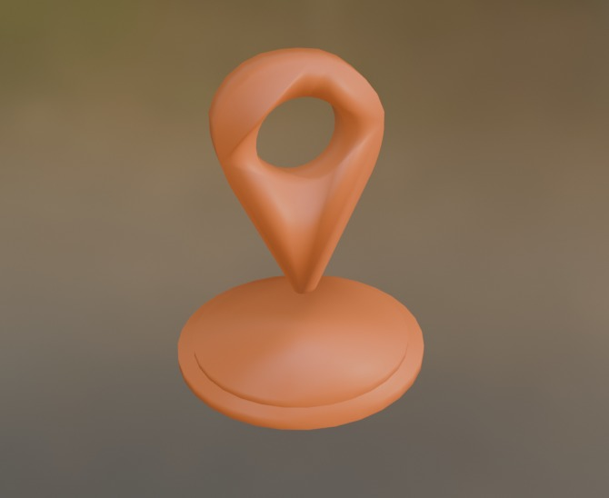
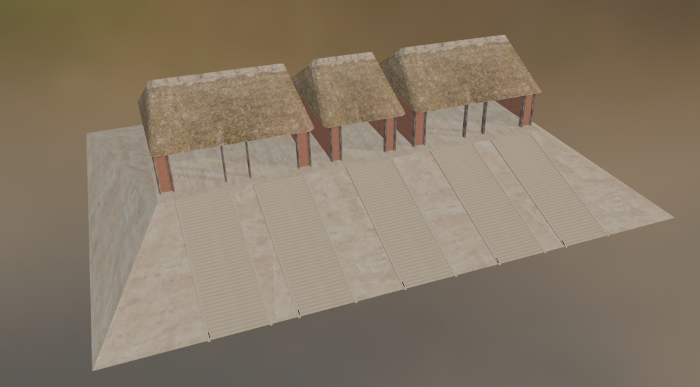
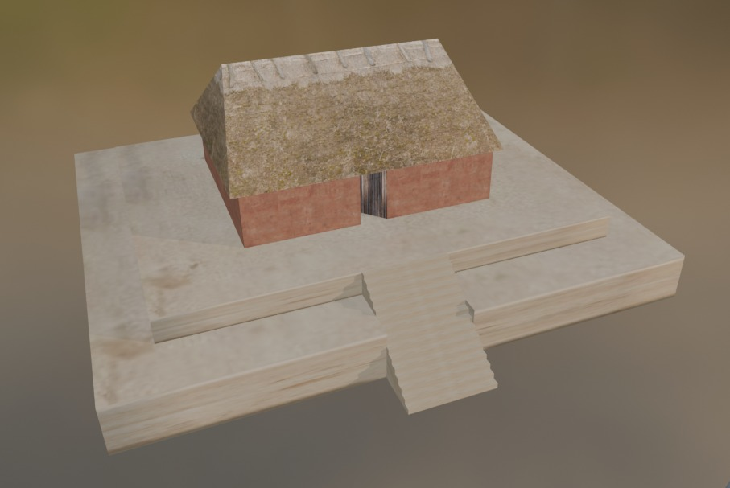
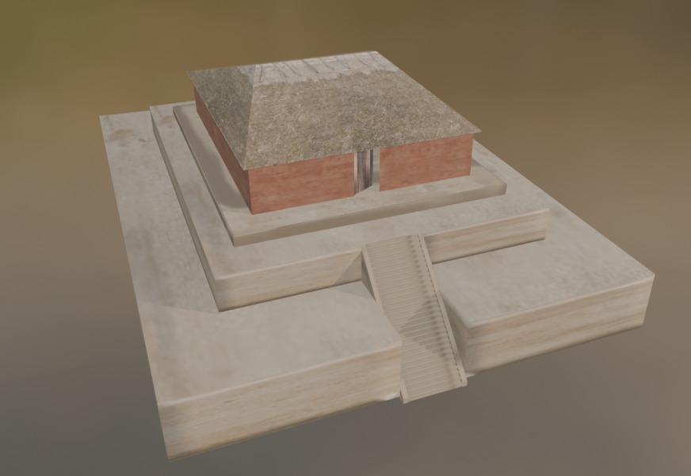
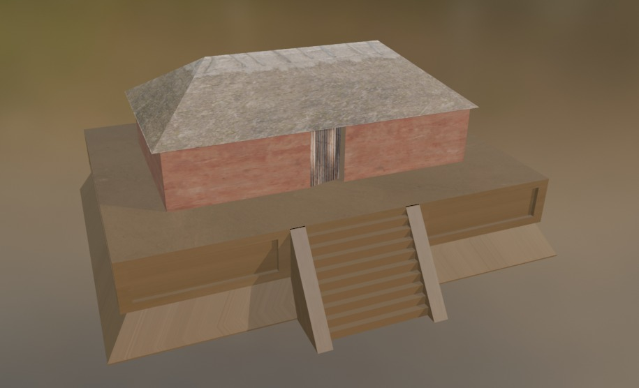
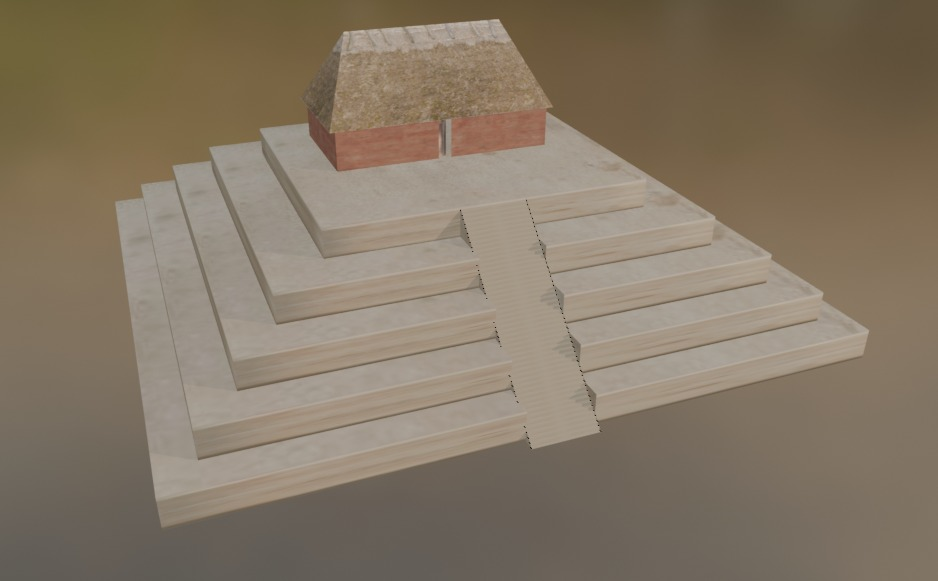
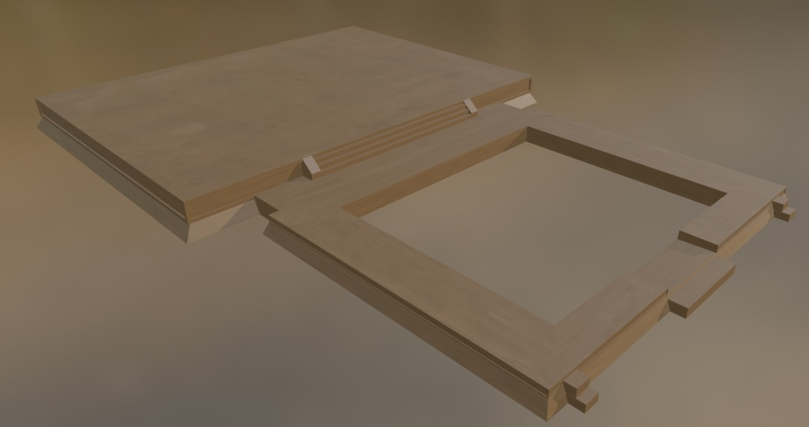
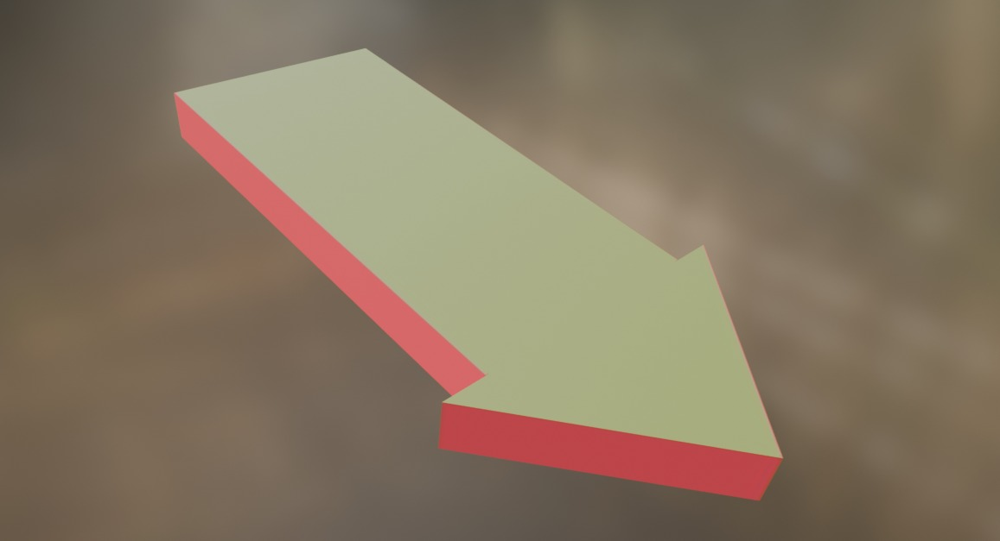
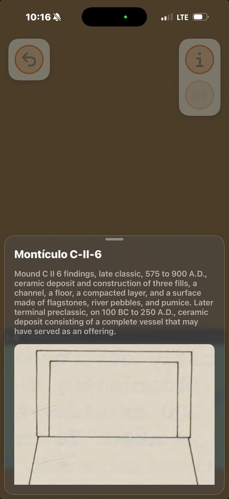
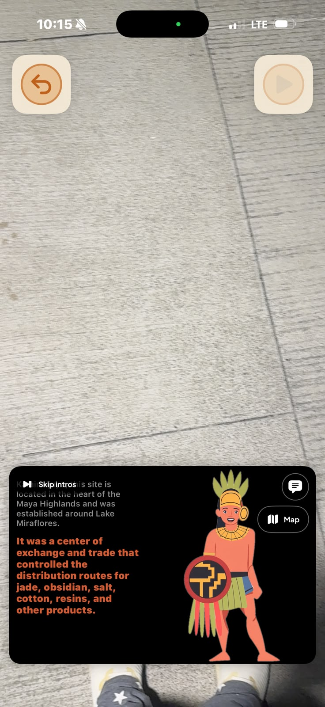
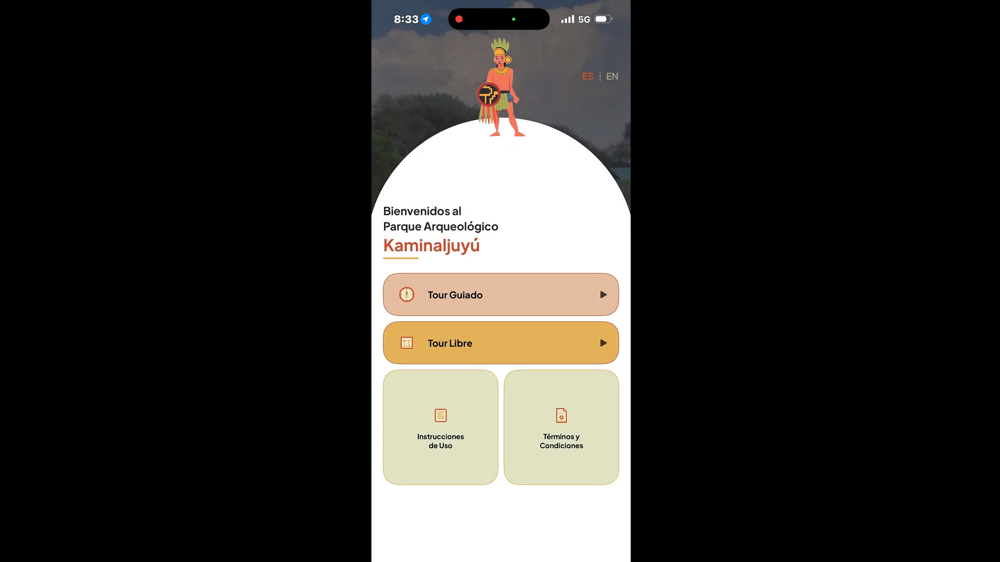
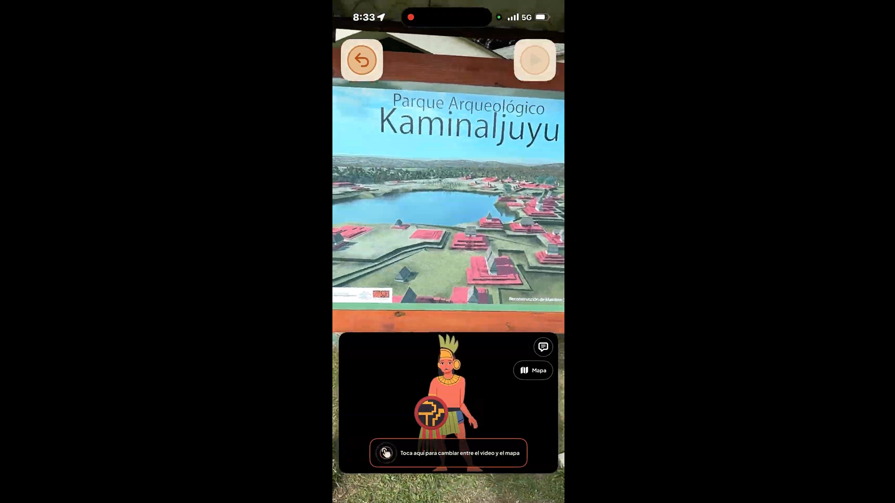
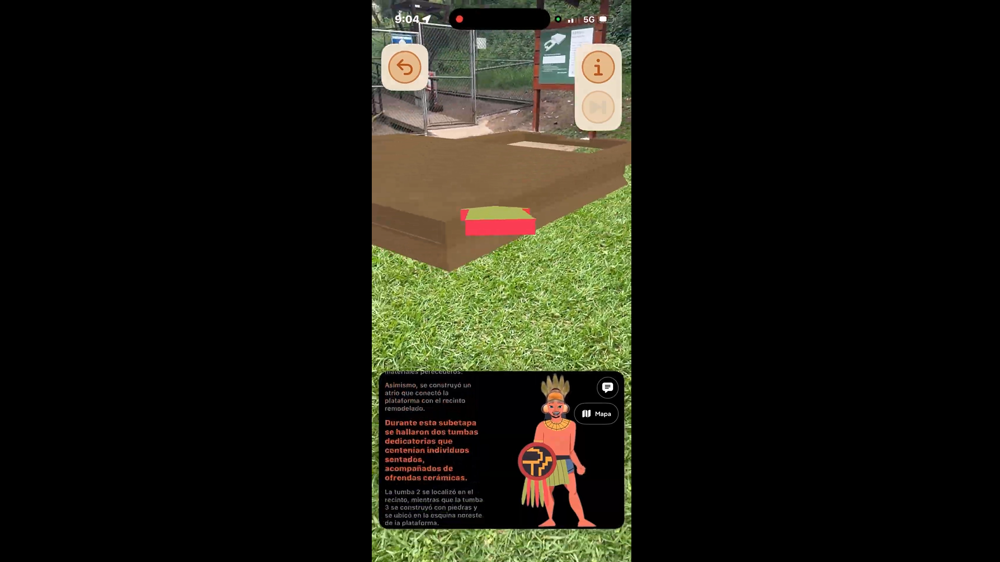

## Demo

El video demostrativo se encuentra en [/demo/demo.mp4](./demo/demo.mp4).

## Documentación

El informe final del proyecto está disponible en [/docs/informe_final.pdf](./docs/informe_final.pdf).

El consentimiento de uso de foto y video firmado se encuentra en [/docs/consentimiento_firmado.pdf](./docs/consentimiento_firmado.pdf).

La documentación técnica de la arquitectura (módulos, flujo del tour, decisiones de diseño y deuda técnica) está en [`estado.md`](./src/AR-Tour-Kaminaljuyu-iOS/ArTourKaminaljuyu/ArTourKaminaljuyu/estado.md).

## Autores

- Andre Yatmian Jo Mai - 22199
- Nancy Gabriela Mazariegos Molina - 22513
- José Santiago Pereira Alvarado - 22318
- Mónica Alejandra Salvatierra Chacón - 22249

